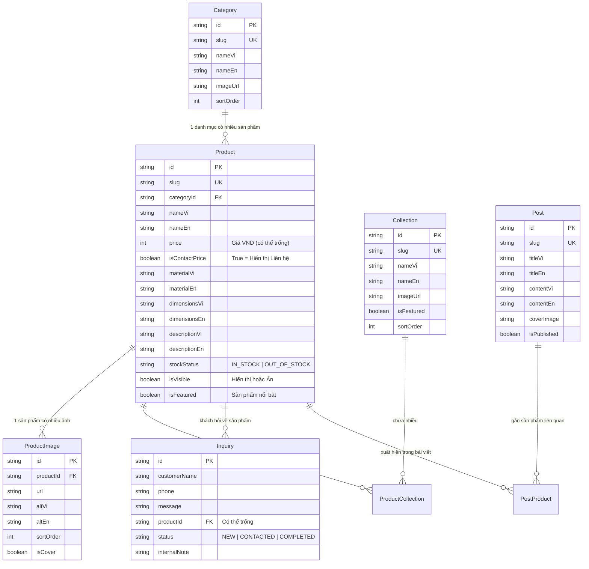
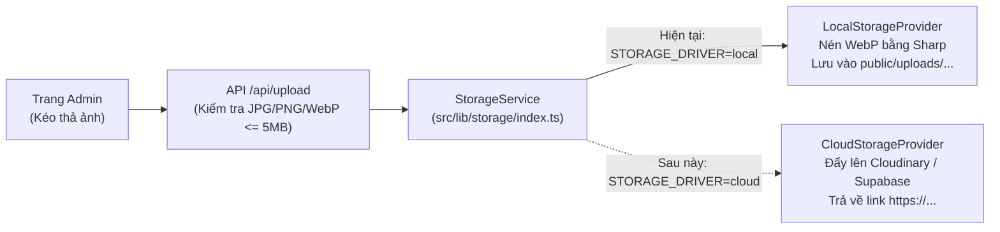

# KẾ HOẠCH XÂY DỰNG WEBSITE TRƯNG BÀY SẢN PHẨM — WOODEN DECOR (`PLAN.md`)

> [!NOTE]
> Tài liệu này được soạn dành riêng cho người mới bắt đầu, bám sát 100% tài liệu phân tích yêu cầu (URD) và bộ ảnh thực tế trong file `ảnh_decore.zip` (thương hiệu **Wooden Decor** — nội thất & đồ trang trí bằng gỗ tự nhiên).
> **Nguyên tắc làm việc:** Chúng ta chưa viết code ngay. Sau khi bạn duyệt kế hoạch này, chúng ta sẽ đi từng bước nhỏ, có giải thích dễ hiểu và kiểm tra kết quả sau mỗi bước.

---

## 1. Tổng quan công nghệ (Giải thích đơn giản)

| Công nghệ | Vai trò trong dự án (Giải thích dễ hiểu) |
| :--- | :--- |
| **Next.js (App Router) + TypeScript** | Bộ khung chính giúp tạo cả **giao diện cho khách xem** lẫn **phần xử lý máy chủ (Backend / Admin)** trong cùng một dự án. Hỗ trợ tiếng Việt, tốc độ tải nhanh và rất tốt cho Google (SEO). |
| **Tailwind CSS** | Công cụ trang trí giao diện nhanh chóng, giúp cài đặt sẵn bộ màu **Trắng kem & Nâu gỗ ấm** (`#FFFFFF`, `#F7F3EC`, `#D9C2A3`, `#A9784B`, `#5B3A29`, `#2B2118`) và chữ sang trọng theo phong cách Apple / Nike. |
| **SQLite + Prisma** | **SQLite** lưu toàn bộ dữ liệu vào đúng 1 file (`dev.db`) ngay trên máy Windows của bạn mà không cần cài phần mềm cơ sở dữ liệu phức tạp. **Prisma** là "phiên dịch viên" giúp code đọc/ghi dữ liệu dễ dàng và sau này đổi sang PostgreSQL rất nhanh. |
| **Sharp (Xử lý ảnh)** | Thư viện tự động thu nhỏ, nén và chuyển ảnh sang định dạng `.webp` siêu nhẹ khi chủ shop tải ảnh lên (giúp ảnh như file `logo.png` 4.7 MB trong file zip giảm còn vài chục KB mà vẫn nét). |
| **Storage Service (Tách lớp Upload)** | Viết riêng một bộ xử lý lưu ảnh: hiện tại lưu vào `public/uploads`, sau này muốn chuyển lên đám mây (Cloudinary / Supabase) chỉ cần thay đúng 1 file cấu hình. |

---

## 2. Cấu trúc thư mục dự án

Dự án sẽ được đặt tại `C:\Users\nstra\.gemini\antigravity\scratch\wooden-decor` với cấu trúc rõ ràng, tách biệt từng phần:

```text
wooden-decor/
├── prisma/
│   ├── schema.prisma          # Khai báo các bảng dữ liệu (Sản phẩm, Danh mục, Admin...)
│   ├── seed.ts                # File nạp dữ liệu mẫu ban đầu kèm 26 ảnh từ file zip
│   └── dev.db                 # File cơ sở dữ liệu SQLite (tự động tạo)
│
├── public/
│   └── uploads/               # Nơi lưu ảnh tải lên (giai đoạn chạy trên máy)
│       ├── logo/              # Chứa logo Wooden Decor đã tối ưu
│       ├── banners/           # Ảnh banner trang chủ
│       ├── categories/        # Ảnh đại diện danh mục & bộ sưu tập
│       └── products/          # Ảnh sản phẩm (tự động nén sang WebP)
│
├── src/
│   ├── app/                   # Các trang của website (theo chuẩn Next.js App Router)
│   │   ├── [locale]/          # Nhánh trang dành cho KHÁCH (hỗ trợ /vi/... và /en/...)
│   │   │   ├── layout.tsx     # Khung chung: Thanh menu trên cùng, Chân trang, Nút gọi/Zalo
│   │   │   ├── page.tsx       # Trang chủ (Banner lớn, Danh mục, Bộ sưu tập, Nổi bật...)
│   │   │   ├── san-pham/      # Trang danh sách sản phẩm + Bộ lọc + Tìm kiếm
│   │   │   │   └── [slug]/    # Trang chi tiết từng sản phẩm
│   │   │   ├── bo-suu-tap/    # Trang xem sản phẩm theo Bộ sưu tập
│   │   │   ├── cam-hung/      # Trang bài viết / Cảm hứng decor (nếu bật mục 15.4)
│   │   │   ├── gioi-thieu/    # Trang câu chuyện thương hiệu Wooden Decor
│   │   │   └── lien-he/       # Trang liên hệ, bản đồ & form gửi yêu cầu tư vấn
│   │   │
│   │   ├── admin/             # Nhánh trang QUẢN TRỊ cho chủ shop (chỉ tiếng Việt)
│   │   │   ├── login/         # Trang đăng nhập Admin
│   │   │   ├── page.tsx       # Trang tổng quan (Dashboard: thống kê & lối tắt)
│   │   │   ├── products/      # Quản lý sản phẩm (thêm, sửa, xóa, nhân bản, sửa giá nhanh)
│   │   │   ├── categories/    # Quản lý danh mục (Bàn, Ghế, Giường, Kệ...)
│   │   │   ├── collections/   # Quản lý bộ sưu tập (Phòng khách tối giản, Phòng ngủ...)
│   │   │   ├── inquiries/     # Quản lý yêu cầu tư vấn của khách gửi về
│   │   │   ├── posts/         # Quản lý bài đăng hằng ngày (mục 15.4)
│   │   │   └── settings/      # Cài đặt chung (Logo, SĐT, Zalo, Địa chỉ, Banner...)
│   │   │
│   │   └── api/               # Các đường dẫn xử lý ngầm ở máy chủ (Backend API)
│   │       ├── auth/          # Xử lý đăng nhập, đăng xuất, đổi mật khẩu
│   │       ├── upload/        # Nhận file ảnh, kiểm tra dung lượng & gọi lớp Storage
│   │       ├── inquiries/     # Nhận yêu cầu tư vấn của khách (có chống spam)
│   │       └── admin/         # Các thao tác thêm/sửa/xóa bảo mật cho Admin
│   │
│   ├── components/            # Các khối giao diện dùng lại nhiều lần
│   │   ├── client/            # Giao diện trang khách (ProductCard, Navbar, ImageGallery...)
│   │   ├── admin/             # Giao diện trang quản trị (ImageUploader, QuickPriceInput...)
│   │   └── ui/                # Các nút bấm, hộp thoại xác nhận, thông báo
│   │
│   ├── dictionaries/          # Từ điển chữ cố định trên giao diện (Menu, Nút bấm...)
│   │   ├── vi.json            # Bản tiếng Việt (Mặc định)
│   │   └── en.json            # Bản tiếng Anh
│   │
│   └── lib/                   # Các bộ công cụ dùng chung
│       ├── prisma.ts          # Kết nối cơ sở dữ liệu
│       ├── auth.ts            # Kiểm tra đăng nhập & khóa khi nhập sai mật khẩu nhiều lần
│       ├── i18n.ts            # Hàm lấy nội dung 2 ngôn ngữ (tự lấy tiếng Việt nếu tiếng Anh trống)
│       └── storage/           # ⭐ LỚP UPLOAD ẢNH TÁCH RIÊNG (xem mục 4)
│           ├── types.ts       # Quy định chuẩn đầu vào / đầu ra khi lưu ảnh
│           ├── local.ts       # Lưu ảnh vào public/uploads + nén WebP bằng Sharp
│           ├── cloud.ts       # Khung chờ sẵn cho Cloudinary / Supabase Storage sau này
│           └── index.ts       # Nơi duy nhất đổi từ Local sang Cloud
│
├── PLAN.md                    # File kế hoạch này
├── .env                       # Lưu cấu hình bí mật (không đưa lên Git)
└── package.json               # Danh sách thư viện của dự án
```

---

## 3. Thiết kế Bảng dữ liệu (Database Schema)

Dựa trên mục 7 và mục 15 của URD, cơ sở dữ liệu gồm **9 bảng** có liên kết chặt chẽ với nhau.

### 3.1 Sơ đồ quan hệ giữa các bảng



### 3.2 Giải thích chi tiết từng bảng dữ liệu

1. **Bảng `AdminUser` (Tài khoản chủ shop)**
   - Lưu `email`, `passwordHash` (mật khẩu đã mã hóa an toàn, không lưu chữ thường).
   - Có thêm `failedAttempts` và `lockedUntil` để chặn đoán mật khẩu nếu nhập sai liên tiếp quá 5 lần (mục 6.1).
2. **Bảng `Category` (Danh mục sản phẩm — mục 6.5 & 15.2)**
   - Phân loại theo công năng: *Giường gỗ, Ghế & Sofa, Bàn trà & Bàn ăn, Kệ & Tủ trang trí*.
   - Mỗi sản phẩm thuộc về **1 danh mục**. Hệ thống sẽ chặn xóa danh mục nếu bên trong vẫn còn sản phẩm.
3. **Bảng `Collection` & `ProductCollection` (Bộ sưu tập — mục 15.2)**
   - Phân nhóm theo không gian hoặc phong cách: *Phòng khách Điêu khắc (Sculptural Living), Phòng ngủ Ấm cúng (Warm Bedroom), Chế tác Thủ công (Handcrafted Masterpieces)*.
   - Một sản phẩm có thể nằm trong **nhiều bộ sưu tập** cùng lúc.
4. **Bảng `Product` (Sản phẩm — mục 6.3, 15.1, 15.3)**
   - **Đa ngôn ngữ thông minh:** Các trường chữ (`name`, `description`, `material`, `dimensions`, `priceNote`) đều có cặp `...Vi` và `...En`. Khi khách xem tiếng Anh mà chủ shop chưa nhập ô tiếng Anh, web tự động hiển thị bản tiếng Việt (không bao giờ bị trống).
   - **Quản lý giá linh hoạt:** Lưu giá dạng số nguyên (`price`, ví dụ `18500000` -> hiển thị `18.500.000 ₫`) kèm cờ `isContactPrice` (nếu bật sẽ hiện chữ **"Liên hệ / Contact"** cho hàng đặt đóng riêng).
   - **Trạng thái:** Còn hàng / Hết hàng (`stockStatus`), Hiển thị / Ẩn (`isVisible`), Nổi bật trang chủ (`isFeatured`), và ngày hẹn đăng (`publishedAt`).
5. **Bảng `ProductImage` (Ảnh sản phẩm — mục 6.4)**
   - Lưu đường dẫn ảnh (`url`), chú thích ảnh (`altVi`, `altEn`), thứ tự sắp xếp (`sortOrder`), và đánh dấu ảnh bìa (`isCover`).
   - Ảnh có `sortOrder` tiếp theo sau ảnh bìa sẽ tự động hiện ra khi khách rê chuột vào thẻ sản phẩm trên trang danh sách (hiệu ứng lấy cảm hứng từ Nike.com).
6. **Bảng `Inquiry` (Yêu cầu tư vấn của khách — mục 5.5 & 6.6)**
   - Lưu họ tên, số điện thoại (bắt buộc), lời nhắn, sản phẩm khách đang xem (`productId`), trạng thái xử lý (`NEW` = Mới, `CONTACTED` = Đã liên hệ, `COMPLETED` = Hoàn tất) và ô `internalNote` để chủ shop ghi chú riêng.
7. **Bảng `Post` & `PostProduct` (Bài đăng / Cảm hứng hằng ngày — mục 15.4)**
   - Hỗ trợ chủ shop đăng bài viết mới hằng ngày (tin tức xưởng mộc, cảm hứng bài trí, giới thiệu lô gỗ mới) và gắn các sản phẩm có trong bài viết.
8. **Bảng `SiteSetting` (Cài đặt chung — mục 6.7)**
   - Lưu các thông tin chung mà chủ shop có thể tự sửa bất cứ lúc nào: Tên thương hiệu (*Wooden Decor*), Logo, Số điện thoại, link Zalo, Địa chỉ xưởng/showroom, Giờ mở cửa, Bản đồ nhúng, Ảnh & Tiêu đề Banner trang chủ, Nội dung trang Giới thiệu.

---

## 4. Thiết kế tách riêng phần Upload ảnh (Đổi sang Cloud dễ dàng)

Theo đúng yêu cầu của bạn: *"lưu ảnh trong `public/uploads` nhưng viết code tách riêng phần upload để sau này đổi sang cloud được"*, chúng ta thiết kế như sau:



- **Lợi ích:** Toàn bộ trang Quản trị và Cơ sở dữ liệu chỉ gọi hàm `storageService.uploadFile(file, folder)` và nhận về đường dẫn ảnh (`url`).
- **Hiện tại (trên máy bạn):** `LocalStorageProvider` nhận ảnh, dùng thư viện `sharp` tự động xoay đúng chiều, thu nhỏ cạnh dài về tối đa `1600px`, nén sang `.webp` nhẹ mượt và lưu vào `public/uploads/<thư_mục>/`.
- **Sau này (khi đưa lên mạng):** Chỉ cần điền khóa API vào `.env` và đổi `STORAGE_DRIVER="cloud"`, không phải sửa lại bất kỳ trang giao diện hay bảng dữ liệu nào.

---

## 5. Các bước thực hiện theo thứ tự (Làm từng bước nhỏ)

Chúng ta sẽ chia công việc thành **4 giai đoạn (12 bước nhỏ)**. Ở mỗi bước, tôi sẽ giải thích ngắn gọn mình sắp làm gì, viết code, chạy thử để bạn xem và lưu Git (`git commit`) để luôn an toàn.

### Giai đoạn 1: Khởi tạo dự án, chuẩn bị ảnh & Giao diện Khách (Bản mẫu chốt thiết kế)
* **Bước 1: Tạo khung dự án & chuẩn bị bộ ảnh từ `ảnh_decore.zip`**
  - Khởi tạo dự án Next.js + TypeScript + Tailwind CSS trong thư mục `wooden-decor` và bật Git.
  - Giải nén file `ảnh_decore.zip`, dùng script nén `logo.png` (từ 4.7 MB xuống bản nhẹ) và 26 ảnh nội thất gỗ vào `public/uploads/` để dùng làm dữ liệu mẫu thật ngay từ đầu.
* **Bước 2: Cài đặt Bảng màu gỗ, Font chữ & Cơ chế 2 ngôn ngữ (VI / EN)**
  - Cấu hình bảng màu (`#FFFFFF`, `#F7F3EC`, `#D9C2A3`, `#A9784B`, `#5B3A29`, `#2B2118`) và cặp font chữ hỗ trợ đầy đủ tiếng Việt (`Playfair Display` cho tiêu đề sang trọng + `Be Vietnam Pro` cho nội dung dễ đọc).
  - Thiết lập đường dẫn `/vi` (mặc định) và `/en` cùng nút chuyển ngôn ngữ giữ nguyên trang đang xem.
* **Bước 3: Dựng Khung trang chung (Thanh điều hướng, Chân trang, Nút Gọi/Zalo nổi)**
  - Thanh menu trên cùng gọn gàng, hơi trong suốt khi cuộn (phong cách Apple), có menu di động và ô tìm kiếm nhanh.
  - Chân trang ấm áp và nút liên hệ nhanh (Gọi điện + Zalo) cố định ở góc màn hình.
* **Bước 4: Dựng Trang chủ (Homepage)**
  - Banner đầu trang cỡ lớn với ảnh nội thất gỗ nghệ thuật và nút kêu gọi hành động (phong cách Nike).
  - Các khối: Danh mục sản phẩm, Bộ sưu tập nổi bật, Sản phẩm tiêu biểu, Câu chuyện chế tác thủ công tại xưởng (sử dụng các ảnh xưởng mộc thực tế trong file zip), và Khối liên hệ.
* **Bước 5: Dựng Trang Danh sách sản phẩm, Chi tiết sản phẩm, Giới thiệu & Liên hệ**
  - **Trang danh sách:** Lưới thẻ ảnh lớn (rê chuột hiện ảnh thứ 2), lọc theo Danh mục, Bộ sưu tập, Khoảng giá, Sắp xếp.
  - **Trang chi tiết:** Bộ ảnh bên trái (bấm phóng to, vuốt trên điện thoại), thông tin + nút *"Gọi ngay"*, *"Chat Zalo"*, *"Gửi yêu cầu tư vấn"* giữ cố định bên phải khi cuộn.
  - **Trang Giới thiệu, Liên hệ & 404.**

### Giai đoạn 2: Cơ sở dữ liệu (SQLite + Prisma) & Trang Quản trị (Admin)
* **Bước 6: Tạo Cơ sở dữ liệu SQLite & Nạp dữ liệu thật (Seed)**
  - Cài đặt Prisma + SQLite, tạo 9 bảng dữ liệu đã thiết kế ở Mục 3.
  - Chạy lệnh tạo dữ liệu mẫu tự động gắn 26 ảnh trong file zip vào các sản phẩm, danh mục, bộ sưu tập và tài khoản Admin mặc định.
* **Bước 7: Xây dựng Đăng nhập `/admin/login` & Trang Tổng quan (Dashboard)**
  - Đăng nhập bằng email & mật khẩu mã hóa, tự động khóa tạm thời nếu nhập sai quá số lần quy định, chức năng đổi mật khẩu và đăng xuất.
  - Bảo vệ toàn bộ đường dẫn `/admin/*` ở phía máy chủ.
  - Trang Dashboard hiển thị tổng số sản phẩm, số sản phẩm đang ẩn, số yêu cầu tư vấn mới của khách và các nút lối tắt.
* **Bước 8: Quản lý Danh mục & Bộ sưu tập**
  - Giao diện bảng đơn giản để chủ shop thêm, sửa (2 ngôn ngữ), sắp xếp thứ tự, đổi ảnh đại diện và xóa (có kiểm tra không cho xóa danh mục đang còn sản phẩm).
* **Bước 9: Quản lý Sản phẩm (Thêm, Sửa, Nhân bản & Sửa giá nhanh)**
  - Bảng danh sách sản phẩm có tìm kiếm, lọc, nút **Sửa giá nhanh ngay trên danh sách**, nút **Tăng/giảm giá hàng loạt theo %**, và nút **Nhân bản sản phẩm** (giúp đăng hàng mới mỗi ngày cực nhanh).
  - Form thêm/sửa sản phẩm 2 ngôn ngữ, tùy chọn giá công khai hoặc *"Liên hệ"*, trạng thái Còn hàng/Hết hàng, Ẩn/Hiện.

### Giai đoạn 3: Lớp Upload ảnh, Yêu cầu tư vấn, Bài đăng & Cài đặt chung
* **Bước 10: Xây dựng lớp Upload ảnh tách biệt (`StorageService`) & Quản lý ảnh sản phẩm**
  - Viết module `src/lib/storage/` tách riêng Local và Cloud.
  - Tạo giao diện kéo-thả nhiều ảnh cùng lúc trong trang Admin, tự động nén WebP, chọn ảnh bìa, đổi thứ tự ảnh và ghi chú thích ảnh.
* **Bước 11: Form Yêu cầu tư vấn, Quản lý yêu cầu & Cài đặt chung của Web**
  - Kết nối form *"Gửi yêu cầu tư vấn"* của khách vào cơ sở dữ liệu (kèm bẫy chống spam ẩn và giới hạn tần suất gửi).
  - Trang `/admin/inquiries` để chủ shop xem khách nào vừa nhắn, đổi trạng thái (*Mới -> Đã liên hệ -> Hoàn tất*) và ghi chú nội bộ.
  - Trang `/admin/settings` để chủ shop tự đổi Logo, Banner trang chủ, Số điện thoại, Zalo, Địa chỉ, Giờ mở cửa và trang Cảm hứng/Bài đăng hằng ngày.

### Giai đoạn 4: Hoàn thiện SEO, Sao lưu & Nghiệm thu
* **Bước 12: Tối ưu SEO, Chia sẻ Zalo/Facebook & Công cụ Sao lưu**
  - Cấu hình tiêu đề, mô tả và ảnh thu nhỏ (OpenGraph) để khi gửi link sản phẩm qua Zalo/Facebook hiện ảnh và giá đẹp mắt; tạo `sitemap.xml` và dữ liệu có cấu trúc cho Google.
  - Tạo lệnh sao lưu 1 chạm (`npm run backup`) tự động đóng gói file cơ sở dữ liệu `dev.db` và thư mục `public/uploads` ra file `.zip` theo ngày.
  - Kiểm tra toàn bộ tiêu chí nghiệm thu trên cả giao diện điện thoại (360px+) và máy tính.

---

## 6. Các quyết định đã chốt từ chủ shop

1. **Hiển thị tiền tệ khi khách bấm sang tiếng Anh (`EN`) (mục 15.1):**
   - **Đã chốt:** Hiển thị giá **VND kèm quy đổi USD ước tính** (ví dụ: `48.000.000 ₫ (~$1,920)`). Tỷ giá quy đổi mặc định là `25.000 VND = 1 USD` và chủ shop có thể tự chỉnh tỷ giá này trong trang **Cài đặt chung (`/admin/settings`)**.
2. **Mục "Cập nhật bài đăng hằng ngày" (mục 15.4):**
   - **Đã chốt:** Thực hiện **cả 2**:
     - Công cụ thao tác nhanh cho Sản phẩm: *Nhân bản sản phẩm, Sửa giá nhanh trên danh sách, Tăng/giảm giá hàng loạt theo %, Lưu nháp / Hẹn giờ đăng*.
     - Mô-đun *Bài viết / Cảm hứng Decor (`/cam-hung` & `/admin/posts`)*: Đăng bài viết 2 ngôn ngữ, ảnh bìa, gắn sản phẩm liên quan và hiển thị bài mới trên Trang chủ.
